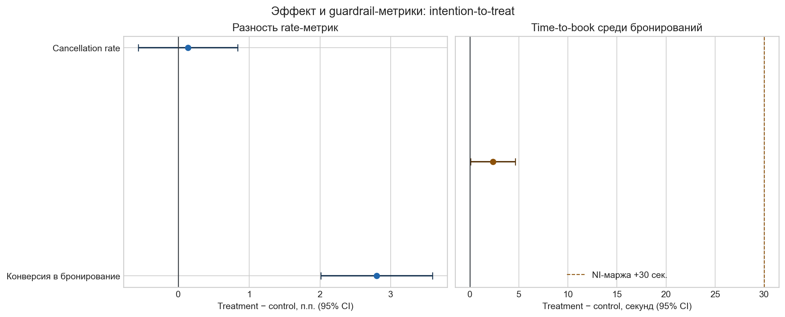
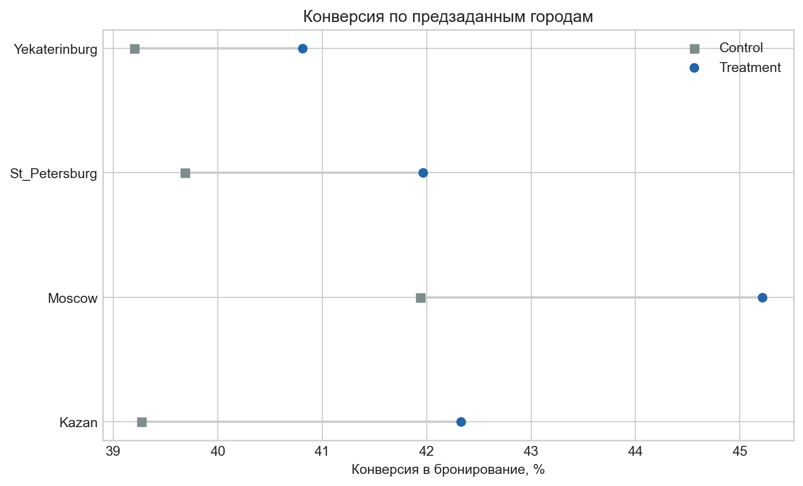

# A/B-тест подсказки при бронировании — технический отчёт

## Техническое резюме

**Решение: LAUNCH.** В synthetic ITT-когорте подсказка повысила conversion to booking
на **2.80 п.п.**: 40.64% →
43.44% (95% CI 2.01…
3.59 п.п.; Holm p=3.682e-12). Это больше
предзаданного продуктового порога 0.7 п.п. Cancellation rate и
time-to-book прошли non-inferiority относительно марж +1.0 п.п.
и +30 сек. соответственно.

Данные и результат целиком синтетические: это демонстрация аналитического процесса, а
не измерение поведения клиентов или результатов какого-либо оператора каршеринга.

## Эффект виден в primary, а guardrail-метрики не ухудшились

Основной тест — односторонний тест превосходства для treatment − control по
конверсии. Guardrails тестируются как non-inferiority: рост cancellation rate не
должен достигать +1.0 п.п., а рост time-to-book —
+30 секунд. Для трёх заранее заявленных решений
применена Holm-поправка к p-value, контролирующая family-wise error rate.

| Метрика | Control | Treatment | Разность treatment − control | 95% CI | Holm p | Критерий |
| --- | ---: | ---: | ---: | --- | ---: | --- |
| Conversion to booking | 40.64% | 43.44% | 2.80 п.п. | 2.01…3.59 п.п. | 3.682e-12 | рост > 0 |
| Cancellation rate среди бронирований | 8.85% | 8.99% | 0.14 п.п. | -0.57…0.84 п.п. | 0.00804 | NI < +1.0 п.п. |
| Time-to-book среди бронирований | 180.8 с | 183.2 с | 2.4 с | 0.1…4.6 с | 4.891e-123 | NI < +30 с |

## Популяция и определения делают сравнение проверяемым

- **Единица рандомизации и анализа:** пользователь, один раз назначенный в
  `control` или `treatment`; primary-анализ — intention-to-treat, а не только
  увидевшие подсказку.
- **Когорта:** eligible пользователи с первым экраном бронирования после
  assignment и минимум 24 часами наблюдения. В каждом варианте: control
  n=29,854, treatment n=30,146.
- **Primary:** `booking_created` в течение 24 часов после первого просмотра
  экрана / все пользователи когорты.
- **Guardrails:** отмена в 24 часа после созданного бронирования / все созданные
  бронирования; `time_to_book` — секунды от первого экрана до первого создания
  бронирования, только среди забронировавших.
- **Экспозиция:** в treatment подсказку увидели
  96.4%
  пользователей. Это диагностическая метрика, не фильтр для primary-теста.

SQL-витрина в `sql/experiment_mart.sql` применяет CTE, `INNER/LEFT JOIN`,
агрегации и `ROW_NUMBER()` для дедупликации назначений и выбора первого
релевантного события. Python загружает CSV, фильтрует когорту, использует
`merge`, `groupby` и независимые статистические функции.

## Рандомизация и качество данных не дают явного повода не доверять оценке

SRM: control=29,854, treatment=30,146,
χ²=1.421, p=0.2332. При α=0.01 SRM не обнаружен.
Из 11 автоматических проверок качества пройдены 11:
уникальность assignment и event_id, отсутствие пересечений вариантов и показа
в control, временная корректность, покрытие JOIN и один пользователь на строку
витрины. Полная таблица — в `reports/data_quality_report.md`.

## Мощность достаточна для практического, а не только статистического эффекта

До чтения результатов зафиксированы α=0.05, целевая мощность
80% и равные плечи. При фактическом baseline
40.64% и n=29,854 на вариант
двусторонний MDE равен **1.13 п.п.**. Наблюдаемый
lift 2.80 п.п. превышает и MDE, и бизнес-порог
0.7 п.п.; поэтому статистическая значимость здесь имеет
продуктовый смысл.

## Сегменты — диагностический срез, а не поиск победителя

Срезы по `platform`, `city`, `is_new_user` и `trips_30d_bucket` определены до
анализа по признакам, доступным до treatment. Ни один сегмент не использован для изменения решения; все срезы предзаданы, а 12 p-value скорректированы Holm внутри сегментного семейства. Данные не
подтверждают отдельный таргетинг: текущая рекомендация относится к общей
eligible-аудитории.

## Ограничения и устойчивость вывода

- Синтетическая генерация не воспроизводит реальную сезонность, стоимость
  коммуникации, конкурирующие эксперименты и задержки событий.
- Cancellation rate и time-to-book условны на бронировании; поэтому они
  полезны как operational guardrails, но не заменяют downstream-метрики
  выполненной поездки и выручки.
- Non-inferiority задана операционными маржами, а не бизнес-моделью. В реальном
  запуске их нужно согласовать с командой и зафиксировать до эксперимента.
- ITT даёт причинную оценку назначения варианта; эффект именно показа подсказки
  требовал бы отдельного инструментального анализа и строгой проверки логирования.

## Следующий шаг

Запустить постепенный rollout на 50% eligible-трафика на 2 недели, сохранив
assignment и event-логирование. Мониторить conversion, cancellation и
time-to-book ежедневно без многократной остановки теста; для решения после
rollout заранее зафиксировать окно, маржи и правила последовательного анализа.

## Открытые вопросы

Нужно проверить downstream-качество бронирования: start-trip rate, контакт с
поддержкой и маржинальность. Если эффект будет концентрироваться в новых
пользователях, следующий подтверждающий тест можно спланировать именно для
этой когорты, а не ретроспективно менять таргетинг по текущему срезу.
